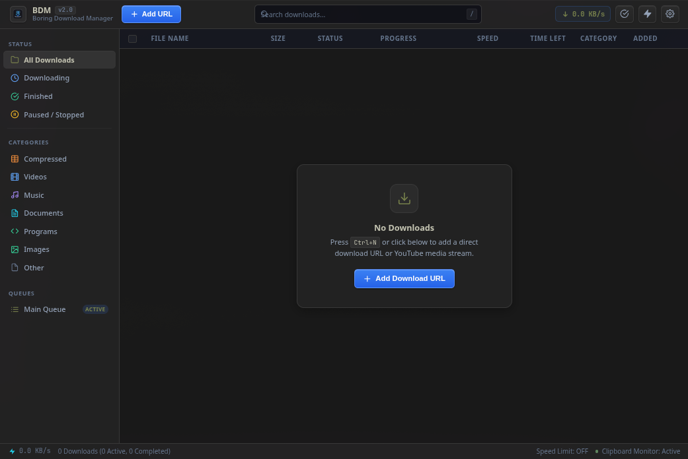
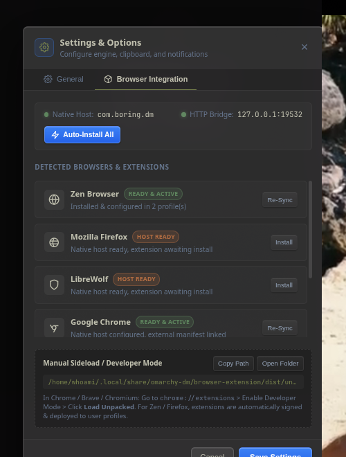

<div align="center">


# Boring Download Manager (BDM)

**Fast, rock-solid multi-stream download accelerator with automatic browser integration for Arch Linux.**

[](#installation)
[](#features)
[](#features)
[](LICENSE)

</div>

---

## ⚡ Highlights

* **Multi-Connection Engine**: Splits files into up to **32 parallel HTTP range streams** for maximum throughput.
* **Automatic Browser Integration**: Automatically detects and configures extensions for **Zen Browser**, **Google Chrome**, **Chromium**, **Brave**, **Mozilla Firefox**, and **LibreWolf**.
* **Real-Time Link Interception**: Clicking a download link in your browser immediately brings BDM to the front with the target URL pre-filled.
* **Media & Video Grabber**: Integrated support for 1000+ video streaming sites via `yt-dlp` and `ffmpeg`.
* **System Tray & Background Persistence**: Runs silently in the system tray (`StatusNotifierItem` / AppIndicator), with dynamic download speed in the tooltip and window minimize-to-tray.
* **Universal Desktop & Modern Dark Theme**: Crisp interface built for high-DPI Wayland and X11, with a sleek dark theme that fits naturally into any desktop environment on Arch Linux.
* **Full CLI + GUI**: Seamless IPC lets you manage downloads from terminal or desktop app interchangeably.

---

## 📸 Screenshots

| Main Download Manager Window | Browser Integration & Settings |
|:---:|:---:|
|  |  |

---

## 🚀 Installation on Arch Linux

### Method 1: One-Line Installer (Recommended)

Run this single command in your terminal:

```bash
curl -fsSL https://raw.githubusercontent.com/whoismj/bdm/main/install.sh | bash
```

> **Note**: For system-wide install (`/usr/lib/bdm` and `/usr/bin/bdm`), run with `sudo`:
> ```bash
> curl -fsSL https://raw.githubusercontent.com/whoismj/bdm/main/install.sh | sudo bash
> ```

---

### Method 2: Git Clone & Local Install

```bash
# 1. Clone repository
git clone https://github.com/whoismj/bdm.git
cd bdm

# 2. Run installer (automatically checks pacman dependencies)
chmod +x install.sh
./install.sh
```

---

### Method 3: Arch Linux PKGBUILD / `makepkg`

```bash
git clone https://github.com/whoismj/bdm.git
cd bdm
makepkg -si
```

---

## 🧩 Browser Integration

BDM automatically configures browser extensions upon launch. You can also view status and manage them anytime via **Settings > Browser Integration** or CLI:

```bash
# Check status of all detected browsers
bdm extensions status

# Re-sync / install extensions for all browsers
bdm extensions install

# Open Browser Integration directly in the GUI
bdm settings
```

### Supported Browsers:
* **Zen Browser**: Auto-deploys signed `.xpi` to profiles, configures `user.js` preferences (`xpinstall.signatures.required: false`, `extensions.autoDisableScopes: 0`), and links native messaging host.
* **Google Chrome / Chromium / Brave Browser**: Auto-registers native messaging host manifests and external extension manifests.
* **Mozilla Firefox & LibreWolf**: Links native messaging host manifests and profile extension drop points.

---

## ⌨️ CLI Usage

BDM includes a powerful CLI tool (`bdm`):

```bash
# Launch GUI
bdm gui
bdm

# Add download URL
bdm add "https://example.com/file.zip"
bdm add "https://example.com/video.mp4" --connections 16
bdm add "https://example.com/file.iso" --gui       # Opens with Add modal in GUI

# Queue management
bdm list                  # List all downloads and status
bdm pause <id>            # Pause a download
bdm resume <id>           # Resume a download
bdm delete <id>           # Remove from list
bdm delete <id> -d        # Remove from list and delete downloaded file

# Settings & Extensions
bdm settings              # Open Settings & Options
bdm extensions status     # Check browser integration status
bdm extensions install    # Re-sync browser extensions
bdm theme                 # View active desktop theme colors
```

---

## 🛠️ Systemd Background Service

BDM includes an optional user service to keep the daemon running continuously in the background:

```bash
# Enable and start user service
systemctl --user enable --now bdm.service

# Check status
systemctl --user status bdm.service
```

---

## 🗑️ Uninstallation

```bash
# If cloned repository:
cd bdm && ./uninstall.sh

# Or via one-liner:
curl -fsSL https://raw.githubusercontent.com/whoismj/bdm/main/uninstall.sh | bash
```

---

## 📜 License

MIT License © 2026 [Mj (whoismj)](https://github.com/whoismj).
